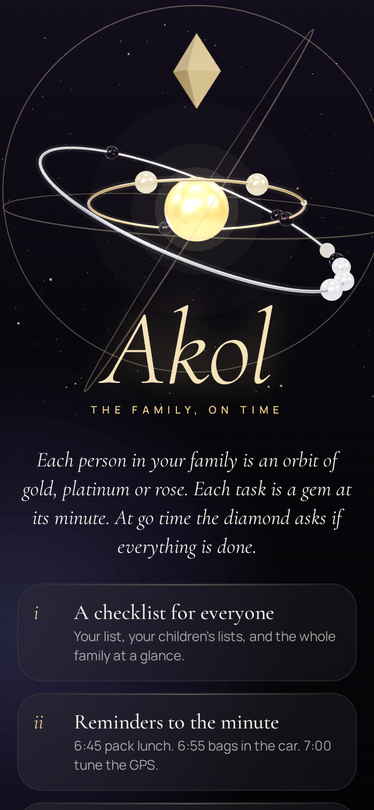
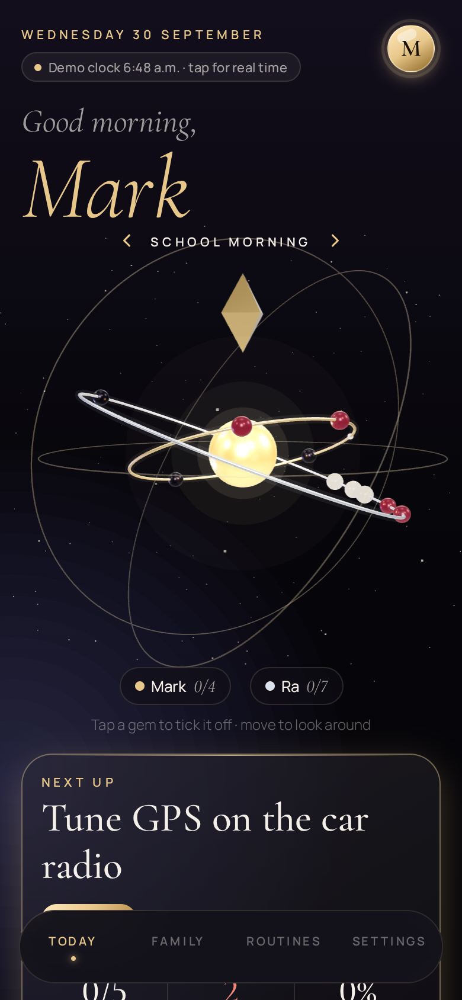
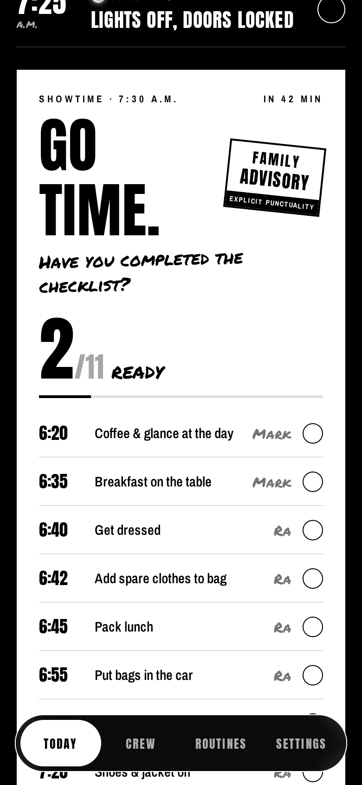
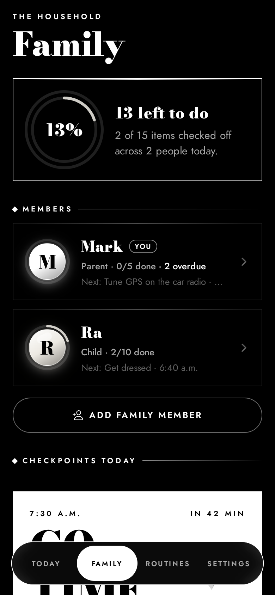

# Akol — the family, on time

A timed family checklist for iOS, Android and the web. Every item has a time: 6:45 pack lunch, 6:55 bags in the car,
7:00 tune the GPS. At a **checkpoint** such as *7:30 Go time* Akol asks: *have you completed the checklist?* It then
shows everyone's open items.

- **My checklist**: the device owner's own list (for example Mark, the dad).
- **Whole family**: every member's items on one timeline, with a colour for each person.
- **Guided setup**: a short questionnaire, in the style of Routinery, builds your week. It asks who it's for, your
  names, what you struggle with, morning and/or evening, when you leave and when it's lights out. It then lets you
  untick suggested tasks, add one-offs and choose notification or alarm. Tasks are timed backwards from Go time.
  `lib/onboarding.ts` holds the logic and is unit-tested.
- **Checkpoints**: gather everything due before them across the family. You can tick items there or mark them all done.
- **Timed reminders**: local notifications fire at the exact minute. Each one has a **Mark done ✓** button, and Akol
  skips the reminder if the item is already ticked.
- **Streaks, progress rings and "next up"**: a countdown to the next item and a warning when something is overdue.
- **Alarm mode**: any item can be set to *Notification* or *Alarm*. An alarm rings on Android's alarm channel and is
  time-sensitive on iOS, so it breaks through Focus and Do Not Disturb. It rings again every 3 minutes, up to 3 more
  times, until someone ticks it.
- **Voice alarms**: the repeat rings play a voice. A parent records *"Hey Ra, it's time to go!"* for each person and
  one for the whole family (Settings → Voice alarms). Without a recording, Akol's own voice plays. Go time in the
  example family is set to Alarm.
- **One-off tasks**: *+ One-off task* on Today, or Routines → *Add a one-off task*. Pick Today, Tomorrow or any date.
  One-offs show only on that day and tidy themselves away two weeks later.
- **Family sync (optional)**: one phone taps *Start family sync* and gets a code such as `AKOL-K7P2QX`. Other phones
  enter the code, and ticks and routine changes then appear on every phone live. There are no accounts or passwords.
- **Backup**: *Save a backup* produces a block of text you keep in Notes or email. Paste it back on a new phone to
  restore. On Android, the phone's own Google backup also covers Akol.
- **Private by default**: without sync, data stays on the device and nothing runs on a server.

<p>
  
  
  
  
</p>

**Design: Side B.** Warm and light, with one loud colour. It borrows the best of the field:
- Tiimo's soft colour blocks on a timeline.
- Routinery's countdown ring for what's up next.
- Cozi's colour for each family member.
- Brili's stars and streaks for the kids.
- One fresh accent (royal mint) for alarms, Go time and selections.

The black Akol mark and the marker-pen tagline *just a-call away* keep the hip hop edge. Type is Nunito. The accent is royal mint. Baby blue and yellow are one word away (`ACCENT` in `src/theme/index.ts`). The bold
black-and-white Side A is in git history (`3492527`).

**Clickable prototype:** `npx expo export -p web && npm run prototype` writes `dist/akol-prototype.html`, a single
self-contained page with the fonts embedded. It can be hosted anywhere. When you pick the example family on the web,
Akol turns on a *demo clock* (6:48 a.m. on weekdays, 8:40 a.m. at weekends), so the morning routine is live whatever the time. Turn it off in
Settings or by tapping the pill on Today.

## Tech (chosen to keep costs low for a solo founder)

| Concern | Choice | Why |
| --- | --- | --- |
| App framework | **Expo SDK 57 / React Native**, TypeScript | One codebase for iOS, Android and web |
| Navigation | Expo Router (`src/app/`) | File-based routes, deep links (`akol://`) |
| Reminders | `expo-notifications` local notifications | Works offline with no push server |
| Storage | AsyncStorage (localStorage on web) | Needs no backend |
| Family sync | Supabase (free tier): anonymous sign-in, Postgres, realtime | $0 for a family app's traffic |
| Builds and store submission | EAS Build / Submit | No Mac needed for iOS builds |

### Project layout

```
src/
  app/                 screens (Expo Router)
    (tabs)/            Today · Family · Routines · Settings
    member/[id].tsx    one person's day
    routine/[id].tsx   edit a routine: days, timeline, checkpoints
    task.tsx           add/edit a reminder (modal)
    member-edit.tsx    add/edit a family member (modal)
    welcome.tsx        first-run onboarding
  components/          design system (gilt cards, jewel avatars, rings, time picker, timeline)
  lib/
    schedule.ts        pure scheduling logic (unit-tested)
    notifications.ts   rolling-window reminder scheduler
    store.tsx          state, persistence, reminder sync
    syncLogic.ts       pure merge, backup and family-code helpers (unit-tested)
    sync.ts            Supabase client: start, join, push, listen
    FamilySync.tsx     keeps this phone and the family in step
    voice.ts           saves recorded voices where notifications can play them
modules/akol-voice/    small Android module: a notification channel per recorded voice
assets/sounds/         Akol's built-in voice (placeholder, see below)
supabase/schema.sql    tables, row-level security and RPCs for family sync
    seed.ts            the "Mark & Ra school morning" example family
  theme/               palette, jewels and typography
tests/                 node:test unit tests for the scheduling logic
```

### How reminders work

iOS allows only 64 pending local notifications per app. Akol doesn't use repeating triggers. Instead it schedules a
**rolling window** of up to 60 one-off reminders over the next few days. It rebuilds that window whenever something
changes and whenever the app comes to the foreground. This also means ticking an item cancels its reminder
("smart skip"), and the text of a checkpoint reminder, such as "3 items still open", stays accurate. On Android 12+,
`SCHEDULE_EXACT_ALARM` lets reminders fire on the exact minute.

### How voice alarms work

iOS plays a notification sound by file name from the app's `Library/Sounds` folder. Recordings are saved there as
`.wav` files of up to 10 seconds; iOS ignores sounds longer than 30 seconds. On Android a sound belongs to a
notification channel and is fixed when the channel is made. `modules/akol-voice` copies each recording to the shared
Notifications folder and makes a channel for it. That module needs Android 10 or later and a development or store
build. In Expo Go, and on older Android versions, the repeats play Akol's built-in voice instead. Recordings stay on
the phone that made them, so they aren't synced or included in text backups.

**Replace the placeholder voice before launch.** `assets/sounds/akol_time_to_go.wav` was made with an open-source
text-to-speech voice whose licence for commercial use is unclear. Record the brand voice yourself, or hire a voice
actor, and save it under the same name: 16-bit `.wav`, mono, under 30 seconds.

### How family sync works

Each phone signs in anonymously, which needs no account or password, and joins a *household* by its 6-character
code. Row-level security means a phone can read only its own household. The family's routines, tasks and members form
one JSON *plan*, and the most recent edit wins. Ticks are stored one row per task per day, so two phones ticking at
the same moment never overwrite each other. Phones push changes as they happen, hear other phones' changes over
Supabase Realtime, and catch up whenever the app opens. A phone that was offline sends its ticks when it reconnects.
Sync is also a backup: on a new phone, join with the same code and everything comes back.

**Switch it on** (about 10 minutes, $0):

1. Create a free project at [supabase.com](https://supabase.com).
2. Open SQL Editor → New query, paste `supabase/schema.sql`, and run it.
3. Go to Authentication → Sign In / Providers and turn on **Allow anonymous sign-ins**.
4. From Project Settings → API, copy the project URL and the `anon` public key into `akol/.env.local` (git ignores it):
   ```
   EXPO_PUBLIC_SUPABASE_URL=https://xxxx.supabase.co
   EXPO_PUBLIC_SUPABASE_ANON_KEY=eyJ...
   ```
   For store builds, add the same two values as EAS environment variables (`npx eas-cli@latest env:create`).

Without these values the app works exactly as before, and Settings shows that sync isn't switched on.

## Run it

```bash
cd akol
npm install
npm start            # scan the QR with Expo Go, or press w for web
npm test             # scheduling unit tests
npm run typecheck
```

**On a real phone today, free:** install **Expo Go** from the App Store or Play Store, run `npm start` on a computer on
the same Wi-Fi, and scan the QR code. Most of Akol works in Expo Go. Notification action buttons, the alarm channel
and time-sensitive alerts need a development or store build. Android builds can be installed straight from an EAS link
with no store account. iPhone builds need the Apple Developer Program and go out through TestFlight.

The best experience is a development build, which gives full notification support including action buttons:
`npx eas-cli@latest build --profile development --platform ios|android`.

## Ship it (cheapest path)

1. Create a free Expo account, then run `npx eas-cli@latest init` to link the project.
2. Change `ios.bundleIdentifier` and `android.package` in `app.json` (now `app.akol.acall`) only if you need to; they can never change once the app is in a store.
3. Replace the placeholder icons in `assets/`: `icon.png` (1024×1024) and the Android adaptive icon layers.
4. `npx eas-cli@latest build --profile production --platform all`, then `npx eas-cli@latest submit`.

Rough costs: Apple Developer Program **$99/year**, paid yearly only (there is no monthly plan), and Google Play
**$25 once**. That makes about **$124 in the first year and $99 a year after that**. The EAS free tier includes a monthly
allowance of cloud builds, which is enough for a solo founder. Supabase's free tier covers family sync. You can
host the web build (`npx expo export -p web`) for free on EAS Hosting, Netlify or Vercel.

Store copy, privacy answers and screenshot captions are in `docs/store-listing.md`; the privacy policy is `docs/privacy-policy.md` (fill in the contact details and host it, e.g. free on GitHub Pages).

Store notes: Google Play asks you to declare why the app needs exact alarms. The declaration is "user-set timed
reminders". Apple and Google both need a privacy policy URL. Since there is no data collection it can be short.

## Roadmap ideas

- **Akol calls you**: a real phone call (Twilio) when an alarm is still not done. Press 1 to tick it. A paid feature.
- True full-screen alarms on iOS through AlarmKit (iOS 26), or Critical Alerts (this needs Apple's approval).
- A kid mode with big buttons and rewards/stickers for streaks.
- Home-screen and lock-screen widgets (iOS WidgetKit / Android Glance via a config plugin).
- Skip-a-day and holiday mode.
- Premium tier ideas: multiple households, shared caregivers (grandparents, nanny), themes.
